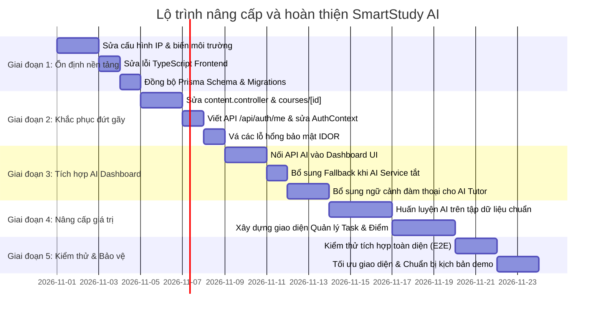

# BÁO CÁO KIỂM TOÁN VÀ ĐÁNH GIÁ TOÀN DIỆN HỆ THỐNG
# SMARTSTUDY AI – HỆ THỐNG HỖ TRỢ HỌC TẬP CÁ NHÂN HÓA TÍCH HỢP TRÍ TUỆ NHÂN TẠO

---

**Thời điểm kiểm toán:** Ngày 28 tháng 10 năm 2026  
**Chuyên gia kiểm định:** Senior Software Architect, Full-Stack Developer & AI Systems Engineer  
**Đối tượng kiểm toán:** Toàn bộ mã nguồn và cấu hình dự án `SmartStudy AI` (Workspace: `f:\DACS4`)  
**Nguyên tắc thực hiện:** Kiểm tra code thực tế, bảo toàn 100% dữ liệu/mã nguồn, không tự ý sửa đổi hoặc giả định kết quả.

---

## MỤC LỤC BÁO CÁO

1. [Tóm tắt điều hành (Executive Summary)](#1-tóm-tắt-điều-hành-executive-summary)
2. [Tổng quan dự án và Kiến trúc hiện tại](#2-tổng-quan-dự-án-và-kiến-trúc-hiện-tại)
3. [Kiểm kê và Phân tích chi tiết chức năng](#3-kiểm-kê-và-phân-tích-chi-tiết-chức-năng)
4. [Đánh giá chuyên sâu từng thành phần](#4-đánh-giá-chuyên-sâu-từng-thành-phần)
   - [4.1 Frontend (React Native & Expo Router)](#41-frontend-react-native--expo-router)
   - [4.2 Backend (Node.js Express & TypeScript)](#42-backend-nodejs-express--typescript)
   - [4.3 Cơ sở dữ liệu (MySQL & Prisma ORM)](#43-cơ-sở-dữ-liệu-mysql--prisma-orm)
   - [4.4 Dịch vụ AI (Python FastAPI & Machine Learning)](#44-dịch-vụ-ai-python-fastapi--machine-learning)
   - [4.5 Tích hợp và luồng dữ liệu hệ thống](#45-tích-hợp-và-luồng-dữ-liệu-hệ-thống)
5. [Đánh giá AI và Mức độ cá nhân hóa (Core Value Analysis)](#5-đánh-giá-ai-và-mức-độ-cá-nhân-hóa-core-value-analysis)
6. [Danh mục ưu điểm và hạn chế kỹ thuật](#6-danh-mục-ưu-điểm-và-hạn-chế-kỹ-thuật)
7. [Đề xuất cải tiến và nâng cấp hệ thống (Nhóm A - B - C)](#7-đề-xuất-cải-tiến-và-nâng-cấp-hệ-thống)
8. [Kế hoạch kiểm thử và Tiêu chí nghiệm thu (Test Plan & Acceptance Criteria)](#8-kế-hoạch-kiểm-thử-và-tiêu-chí-nghiệm-thu)
9. [Lộ trình phát triển và hoàn thiện (Product Roadmap)](#9-lộ-trình-phát-triển-và-hoàn-thiện)
10. [Kết luận và Bảng quyết định triển khai](#10-kết-luận-và-bảng-quyết-định-triển-khai)

---

## 1. TÓM TẮT ĐIỀU HÀNH (EXECUTIVE SUMMARY)

Dự án **SmartStudy AI** được định vị là ứng dụng hỗ trợ học tập cá nhân hóa tích hợp trí tuệ nhân tạo dành cho sinh viên đại học. Dự án bao gồm 3 phân hệ chính:
1. **Frontend:** Ứng dụng di động đa nền tảng xây dựng trên React Native (0.88), Expo (v58), Expo Router (v58) và TypeScript.
2. **Backend API:** Máy chủ RESTful API xây dựng trên Express (v5.3), TypeScript, Prisma ORM (v6.19) kết nối cơ sở dữ liệu MySQL.
3. **AI Service:** Máy chủ tính toán học máy phân tích nguy cơ học tập xây dựng trên Python, FastAPI (v0.110), Scikit-Learn và tích hợp mô hình OpenAI GPT-4o-mini qua API.

### Kết quả thẩm định tổng thể:
- **Mức độ hoàn thiện chức năng:** Đạt khoảng **60% - 65%** so với mục tiêu một sản phẩm phần mềm hoàn chỉnh.
- **Tình trạng hoạt động:**
  - **Phần đã hoạt động tốt:** Cơ chế xác thực JWT, Luồng làm bài kiểm tra trắc nghiệm (Quiz), Chấm điểm và phân tích năng lực theo thẻ kỹ năng (`skill_tag`), Ghi nhận phiên bấm giờ học tập (Pomodoro / Study Session), Chat cơ bản với OpenAI / Mock AI, Tính điểm trung bình môn học theo trọng số tín chỉ.
  - **Điểm đứt gãy kiến trúc nghiêm trọng nhất (Critical Bottleneck):** **Dịch vụ AI (Python FastAPI) hoàn toàn chưa được kết nối với giao diện người dùng (Frontend).** Endpoint `GET /api/ai/dashboard-analysis` đã được viết ở backend nhưng màn hình Dashboard (`index.tsx`) không hề gọi endpoint này. Thay vào đó, Dashboard chỉ tải thống kê tổng hợp và lộ trình sinh bằng rule-based thô sơ.
  - **Lỗi đứt gãy dữ liệu màn hình (Broken Data Contract):** Tại màn hình chi tiết môn học `courses/[id].tsx`, danh sách bài giảng và quiz bị ép cứng fallback trỏ về `Material ID = 1` và `Quiz ID = 1` do controller backend `content.controller.ts` không `include` quan hệ bài học và quiz.
  - **Vấn đề cấu hình mạng:** Mã nguồn Frontend đang ghim cứng địa chỉ IP mạng nội bộ riêng lẻ (`http://192.168.101.78:3000/api` tại `axiosClient.ts`, `http://192.168.1.5:3000/api` tại `src/services/api.ts`, và `http://192.168.1.208:3000/health` tại `test-connection.tsx`). Khi chạy trên thiết bị khác hoặc mạng khác, ứng dụng sẽ timeout và báo lỗi mạng toàn bộ.
  - **Lỗ hổng bảo mật kiểm soát truy cập (IDOR):** Tồn tại lỗ hổng IDOR tại API cập nhật trạng thái nhiệm vụ lộ trình (`PATCH /api/study-plans/items/:id/status`) và API chat gia sư (`POST /api/tutor/chat`).
  - **Thực trạng Machine Learning:** Mô hình `RandomForestClassifier` đạt F1-Score 0.9916 vì được huấn luyện trên 1.200 mẫu dữ liệu giả lập (synthetic data) có nhãn được sinh ra từ chính một hàm IF-ELSE 5 dòng. Mô hình thực chất chỉ đang học lại luật if-else do người lập trình tự quy ước, chưa đại diện cho bài toán giáo dục thực tế.

---

## 2. TỔNG QUAN DỰ ÁN VÀ KIẾN TRÚC HIỆN TẠI

### 2.1 Sơ đồ kiến trúc hiện tại (Mermaid Architecture Diagram)

```mermaid
flowchart TB
    subgraph Client_Layer ["Mobile Client (Expo / React Native)"]
        UI_Home["Dashboard (index.tsx)"]
        UI_Courses["Courses & Details (courses.tsx, [id].tsx)"]
        UI_Quiz["Quiz Runner & Result (quiz/[id].tsx, result/[id].tsx)"]
        UI_Plan["Study Plan (plan.tsx)"]
        UI_Tutor["AI Tutor Chat (tutor.tsx)"]
        UI_Profile["Profile & Timer (profile.tsx)"]
        Client_Axios["axiosClient (Hardcoded IP: 192.168.101.78)"]
    end

    subgraph Backend_Layer ["Backend Server (Node.js Express + TypeScript :3000)"]
        Router["Express Router (/api)"]
        Middleware["auth.middleware (JWT Verification)"]
        
        subgraph Controllers ["Controllers"]
            C_Auth["auth.controller"]
            C_Course["course.controller"]
            C_Content["content.controller"]
            C_Quiz["quiz.controller"]
            C_Learning["learning.controller (Rule-based Plan)"]
            C_Tutor["tutor.controller"]
            C_Session["session.controller"]
            C_Task["task.controller (Orphan: No UI)"]
            C_Grade["grade.controller (Orphan: No UI)"]
            C_AI["ai.controller (Disconnected from UI)"]
        end

        PrismaORM["Prisma Client v6.19"]
        AIServiceClient["ai.service.ts (OpenAI SDK / Mock Mode)"]
    end

    subgraph External_AI ["External Cloud AI"]
        OpenAI_API["OpenAI API (gpt-4o-mini)"]
    end

    subgraph Python_AI_Layer ["AI Microservice (FastAPI + Scikit-Learn :8000)"]
        FastAPI_App["FastAPI Engine (main.py)"]
        RF_Model["RandomForestClassifier (risk_model_v1.0.0.joblib)"]
        Rules_Engine["Rule-based Recommendation Engine"]
    end

    subgraph Data_Layer ["Persistence Layer"]
        MySQL_DB[("MySQL Database")]
    end

    %% Client communication
    UI_Home --> Client_Axios
    UI_Courses --> Client_Axios
    UI_Quiz --> Client_Axios
    UI_Plan --> Client_Axios
    UI_Tutor --> Client_Axios
    UI_Profile --> Client_Axios
    Client_Axios -->|HTTP REST / JSON| Router

    %% Backend processing
    Router --> Middleware
    Middleware --> Controllers
    C_Auth --> PrismaORM
    C_Course --> PrismaORM
    C_Content --> PrismaORM
    C_Quiz --> PrismaORM
    C_Learning --> PrismaORM
    C_Session --> PrismaORM
    C_Task --> PrismaORM
    C_Grade --> PrismaORM
    C_Tutor --> PrismaORM
    C_Tutor --> AIServiceClient
    AIServiceClient -->|HTTPS| OpenAI_API

    %% AI Integration
    C_AI -.->|HTTP POST /predict-risk (DISCONNECTED FROM UI)| FastAPI_App
    FastAPI_App --> RF_Model
    FastAPI_App --> Rules_Engine
    C_AI --> PrismaORM

    %% Database queries
    PrismaORM -->|SQL Queries| MySQL_DB
```

### 2.2 Danh mục công nghệ và phiên bản đang sử dụng

| Phân hệ | Công nghệ / Thư viện | Phiên bản | Vai trò kỹ thuật |
| :--- | :--- | :--- | :--- |
| **Frontend** | React Native | 0.88.0 | Nền tảng xây dựng UI di động |
| | React | 19.3.0 | Thư viện UI cốt lõi |
| | Expo SDK | ~58.0.16 | Bộ công cụ phát triển, build và runtime |
| | Expo Router | ~58.0.24 | Định tuyến dựa trên cấu trúc file (File-based Routing) |
| | Axios | ^1.20.0 | Thư viện HTTP client gọi API |
| | Expo SecureStore | ~58.0.2 | Lưu trữ an toàn JWT Token trên thiết bị |
| | Lucide React Native | ^1.61.0 | Hệ thống biểu tượng (Vector Icons) |
| | TypeScript | ~6.0.3 | Kiểm tra kiểu dữ liệu tĩnh |
| **Backend** | Express | ^5.3.0 | Web framework xây dựng REST API |
| | TypeScript | ^5.8.3 | Ngôn ngữ phát triển backend có định kiểu |
| | Prisma ORM | ^6.19.3 | Object-Relational Mapping thao tác MySQL |
| | Bcryptjs | ^3.0.3 | Băm mật khẩu sinh viên (Salt 10) |
| | Jsonwebtoken | ^9.0.3 | Cấp phát và xác thực JWT token |
| | Zod | ^4.6.7 | Thư viện xác thực schema dữ liệu đầu vào |
| | Helmet & CORS | ^8.3.0 / ^2.8.6 | Bảo mật HTTP headers và cấp quyền chia sẻ tài nguyên |
| | OpenAI SDK | ^7.42.0 | Tích hợp gọi mô hình ngôn ngữ lớn GPT-4o-mini |
| **AI Service**| FastAPI | 0.110.0 | ASGI Web framework hiệu năng cao cho Python |
| | Uvicorn | 0.28.0 | ASGI Server chạy ứng dụng FastAPI |
| | Scikit-Learn | 1.4.1post1 | Thư viện huấn luyện Machine Learning |
| | Pandas & NumPy | 2.2.1 / 1.26.4 | Xử lý dữ liệu bảng và tính toán ma trận |
| | Joblib | 1.3.2 | Tuần tự hóa và nạp mô hình đã huấn luyện |
| | Pydantic | 2.6.4 | Xác thực dữ liệu I/O của AI service |
| **Database** | MySQL | 8.0+ | Hệ quản trị cơ sở dữ liệu quan hệ |

### 2.3 Biến môi trường và cấu hình quan trọng (Chỉ nêu tên biến)

- **Backend (`backend/.env`):**
  - `DATABASE_URL`: Chuỗi kết nối cơ sở dữ liệu MySQL (gồm user, password, host, port, db name).
  - `PORT`: Cổng lắng nghe của máy chủ Express (mặc định 3000).
  - `JWT_SECRET`: Khóa bí mật dùng để ký và giải mã JWT token.
  - `OPENAI_API_KEY`: Khóa API gọi dịch vụ OpenAI.
  - `OPENAI_MODEL`: Tên mô hình OpenAI chỉ định (ví dụ `gpt-4o-mini`).
  - `AI_MOCK_MODE`: Cờ bật/tắt chế độ giả lập AI (`true`/`false`) không tốn tiền API.
  - *(Lưu ý thiếu hụt)*: Biến `AI_SERVICE_URL` chưa có trong `.env`, code controller đang dùng giá trị mặc định fallback `http://localhost:8000`.

- **Frontend:**
  - Không có file `.env`. Địa chỉ API đang bị hardcode trực tiếp trong file mã nguồn `src/api/axiosClient.ts`.

- **AI Service:**
  - Sử dụng cấu hình đường dẫn nội bộ tới thư mục `models/`.

### 2.4 Lệnh khởi chạy, build và kiểm thử

- **Backend:**
  - Chạy môi trường phát triển: `npm run dev` (sử dụng `ts-node-dev`).
  - Build biên dịch: `npm run build` (chạy `tsc`).
  - Chạy production: `npm start` (chạy `node dist/index.js`).
  - Khởi tạo dữ liệu mẫu: `npx prisma db seed` (gọi `prisma/seed.ts`).
  - Kiểm thử: Chưa có script test (`npm test` trả về mã lỗi 1).
- **Frontend:**
  - Khởi chạy Expo: `npm run start` hoặc `npx expo start`.
  - Khởi chạy Android: `npm run android`.
  - Khởi chạy Web: `npm run web`.
  - Build ứng dụng: Chưa cấu hình EAS Build (`eas.json` không tồn tại).
  - Kiểm thử: Không có script kiểm thử tự động.
- **AI Service:**
  - Huấn luyện lại mô hình: `python train_model.py`.
  - Khởi chạy FastAPI: `uvicorn main:app --reload --port 8000`.

### 2.5 Phụ thuộc bên ngoài và các rủi ro môi trường khi triển khai trên máy khác

1. **Địa chỉ mạng tĩnh (LAN IP Dependency):** Do frontend trỏ vào IP cứng `192.168.101.78:3000`, người khác clone dự án về chạy trên máy tính cá nhân hoặc kết nối WiFi khác sẽ không thể kết nối tới Backend.
2. **Thiếu biến môi trường đồng bộ:** Không có file `.env.example` ở cả backend và frontend.
3. **Cài đặt thư viện Python C-extensions:** Các thư viện `scikit-learn`, `numpy`, `pandas` cần Microsoft Visual C++ Redistributable trên Windows nếu cài từ source wheels không tương thích.
4. **Prisma Client Generation:** Sau khi clone mã nguồn, bắt buộc phải chạy `npx prisma generate` thì backend TypeScript mới nhận diện được kiểu dữ liệu database.

---

## 3. KIỂM KÊ TOÀN BỘ CHỨC NĂNG

| Nhóm chức năng | Chức năng cụ thể | Vị trí triển khai (File/Module) | API liên quan | Trạng thái | Bằng chứng kiểm tra | Vấn đề còn tồn tại |
| :--- | :--- | :--- | :--- | :--- | :--- | :--- |
| **1. Tài khoản** | Đăng ký tài khoản | `backend/src/controllers/auth.controller.ts`<br>`frontend/app/(auth)/register.tsx` | `POST /api/auth/register` | Đã triển khai & hoạt động | Kiểm tra code: Zod validation, bcrypt băm mật khẩu 10 rounds, xử lý bắt trùng email. | Không gửi email xác thực; Không có trường họ tên, mã sinh viên (chỉ có email). |
| | Đăng nhập hệ thống | `backend/src/controllers/auth.controller.ts`<br>`frontend/app/(auth)/login.tsx` | `POST /api/auth/login` | Đã triển khai & hoạt động | Kiểm tra code: So sánh mật khẩu băm, ký JWT thời hạn 7 ngày, trả về `{token, user}`. | Không có refresh token; Đăng nhập sai không giới hạn số lần (chưa chống brute-force). |
| | Đăng xuất | `frontend/src/context/AuthContext.tsx`<br>`frontend/app/(tabs)/profile.tsx` | Client-side only | Đã triển khai & hoạt động | `SecureStore.deleteItemAsync('jwt_token')`, set user = null, điều hướng về login. | Chưa có API thu hồi token ở server (Token Revocation / Blacklist). |
| | Khôi phục phiên làm việc | `frontend/src/context/AuthContext.tsx` | Không có API | Mới có code mẫu (Fake logic) | Kiểm tra `AuthContext.tsx` (dòng 34): `if (token) setUser({ id: 1, email: 'student@example.com' })` | **Lỗi nghiêm trọng:** Khi mở lại app, luôn gán cứng user ID = 1 bất kể tài khoản nào đã đăng nhập trước đó! |
| | Lấy thông tin hồ sơ (Me) | Chưa có | `GET /api/auth/me` | **Chưa triển khai** | Kiểm tra `auth.routes.ts`: Hoàn toàn không có route `/me`. | Frontend không thể xác thực tính hợp lệ của token khi khởi động app. |
| **2. Quản lý môn học** | Danh mục môn học | `backend/src/controllers/course.controller.ts`<br>`frontend/app/(tabs)/courses.tsx` | `GET /api/courses/catalog` | Đã triển khai & hoạt động | Trả về danh sách `Course` kèm mã môn, tên môn, tín chỉ; hiển thị trong Modal đăng ký môn. | Chưa có tìm kiếm, lọc theo khoa/kỳ học; danh mục không phân trang. |
| | Đăng ký môn học | `backend/src/controllers/course.controller.ts`<br>`frontend/app/(tabs)/courses.tsx` | `POST /api/courses/enroll` | Đã triển khai & hoạt động | Bắt lỗi trùng `[user_id, course_id, semester]` qua Prisma P2002. | Học kỳ bị gán cứng `HK1-2026` trên giao diện, không cho sinh viên chọn học kỳ. |
| | Danh sách môn đã học | `backend/src/controllers/course.controller.ts`<br>`frontend/app/(tabs)/courses.tsx` | `GET /api/courses/my-courses` | Đã triển khai & hoạt động | Tính toán điểm trung bình có trọng số theo các cột điểm đã nhập (`currentAverageScore`). | Khi chưa có cột điểm nào, giao diện không hiển thị trạng thái đang học rõ ràng. |
| **3. Quản lý nội dung** | Danh sách chủ đề môn học | `backend/src/controllers/content.controller.ts`<br>`frontend/app/courses/[id].tsx` | `GET /api/courses/:courseId/topics` | Mới triển khai một phần | API chỉ trả về `Topic` kèm `_count.materials`, không `include` danh sách `materials` và `quizzes`. | **Lỗi nghiêm trọng:** `courses/[id].tsx` không nhận được dữ liệu bài học/quiz nên rơi vào fallback gán cứng ID = 1! |
| | Chi tiết tài liệu bài giảng | `backend/src/controllers/content.controller.ts`<br>`frontend/app/materials/[id].tsx` | `GET /api/materials/:id` | Đã triển khai & hoạt động | Hiển thị bài học Markdown, parser hỗ trợ Heading 1, 2, bullet points, text. | Parser Markdown viết bằng regex đơn giản, chưa hỗ trợ code block C++, hình ảnh, bảng biểu LaTeX. |
| **4. Công việc học tập** | CRUD Nhiệm vụ (Task) | `backend/src/controllers/task.controller.ts` | `GET /api/tasks`<br>`POST /api/tasks`<br>`PATCH /api/tasks/:id/status` | Backend có - Frontend chưa có | Controller viết đầy đủ Zod validation, kiểm tra quyền sở hữu enrollment. | **Chưa có giao diện:** Frontend hoàn toàn không có màn hình quản lý Task để sinh viên tự tạo hay sửa task. |
| **5. Quiz kiểm tra** | Lấy câu hỏi trắc nghiệm | `backend/src/controllers/quiz.controller.ts`<br>`frontend/app/quiz/[id].tsx` | `GET /api/quizzes/:quizId/questions` | Đã triển khai & hoạt động | Ẩn đáp án đúng (`correct_option_index`) và lời giải (`explanation`) khi trả về cho client. Bảo mật tốt. | Thời gian làm bài (`time_limit_minutes`) chỉ đếm ở client, server không đối soát timestamp khi nộp bài. |
| | Nộp bài & Chấm điểm | `backend/src/controllers/quiz.controller.ts`<br>`frontend/app/quiz/[id].tsx` | `POST /api/quizzes/:quizId/submit` | Đã triển khai & hoạt động | Chấm điểm tự động thang 10, phân tích % theo từng `skill_tag`, lưu Prisma Transaction an toàn. | Nộp bài không kiểm tra câu hỏi đó có thực sự thuộc về Quiz đang thi hay không. |
| | Kết quả & Phân tích kỹ năng | `backend/src/controllers/quiz.controller.ts`<br>`frontend/app/quiz/result/[id].tsx` | `GET /api/quiz-attempts/:id` | Đã triển khai & hoạt động | Trả về chi tiết đáp án đã chọn, đáp án đúng, giải thích và biểu đồ thanh tỷ lệ từng `skill_tag`. | Đã kiểm tra quyền sở hữu (`attempt.user_id !== userId`), ngăn chặn xem bài thi của người khác. |
| | Lịch sử làm bài | `backend/src/controllers/quiz.controller.ts` | `GET /api/quiz-attempts/history` | Backend có - Frontend chưa kết nối | Endpoint hoạt động trả về mảng lượt làm bài kèm parse `skill_breakdown`. | Màn hình Profile hoặc Course chưa hiển thị danh sách lịch sử thi để xem lại. |
| **6. Phân tích năng lực** | Mức độ thành thạo chủ đề | `backend/src/controllers/learning.controller.ts` | `GET /api/topics/:topicId/mastery` | Backend có - Chưa có UI riêng | Truy vấn attempt mới nhất của topic, trích xuất `skill_breakdown`. | Chỉ lấy duy nhất 1 bài thi gần nhất, chưa tính trung bình động (moving average) của nhiều bài thi. |
| **7. Lộ trình cá nhân** | Sinh lộ trình học thích ứng | `backend/src/controllers/learning.controller.ts` | `POST /api/study-plans/generate` | Mới triển khai một phần | Rule-based: Nếu kỹ năng < 50% đề xuất ôn lý thuyết; < 80% đề xuất luyện quiz. | **Thiếu mapping chi tiết:** Mọi kỹ năng yếu đều gán vào cùng 1 bài giảng đầu tiên của topic. |
| | Xem lộ trình hiện tại | `backend/src/controllers/learning.controller.ts`<br>`frontend/app/(tabs)/plan.tsx` | `GET /api/study-plans/current` | Đã triển khai & hoạt động | Lấy lộ trình trạng thái `ACTIVE`, hiển thị danh sách nhiệm vụ phân loại theo mức độ ưu tiên. | Không có thông tin môn học gắn với lộ trình; toàn bộ hệ thống chỉ lưu 1 plan active duy nhất cho mỗi user. |
| | Đổi trạng thái nhiệm vụ | `backend/src/controllers/learning.controller.ts`<br>`frontend/app/(tabs)/plan.tsx` | `PATCH /api/study-plans/items/:id/status` | Đã triển khai nhưng có lỗi bảo mật | Cho phép đánh dấu PENDING / DONE trực tiếp trên app. | **Lỗ hổng IDOR:** Không kiểm tra `item.id` có thuộc quyền sở hữu của user đăng nhập hay không! |
| **8. Dự đoán nguy cơ học tập** | Dự đoán nguy cơ (AI Engine) | `ai-service/main.py`<br>`backend/src/controllers/ai.controller.ts` | `POST /predict-risk`<br>`GET /api/ai/dashboard-analysis` | Backend & AI có - Frontend đứt gãy | Backend gọi FastAPI thành công, trích xuất 4 đặc trưng từ CSDL, lưu kết quả vào bảng `Prediction`. | **Chưa nối giao diện:** Dashboard (`index.tsx`) không hề gọi API này. Người dùng không thấy được nguy cơ của mình. |
| **9. Gia sư AI** | Hỏi đáp tương tác với AI | `backend/src/controllers/tutor.controller.ts`<br>`frontend/app/(tabs)/tutor.tsx` | `POST /api/tutor/chat` | Đã triển khai & hoạt động | Hỗ trợ 2 chế độ: Mock AI (miễn phí) và OpenAI GPT-4o-mini qua cấu hình `AI_MOCK_MODE`. | **Mất ngữ cảnh hội thoại:** Controller chỉ gửi câu hỏi hiện tại sang AI, không gửi lịch sử chat trước đó! |
| | Quản lý phiên hội thoại | `backend/src/controllers/tutor.controller.ts`<br>`frontend/app/(tabs)/tutor.tsx` | `GET /api/tutor/sessions`<br>`GET /api/tutor/sessions/:id/messages` | Đã triển khai & hoạt động | Lưu trữ hội thoại trong `TutorSession` và `TutorMessage`. | Lỗ hổng bảo mật: Khi gửi `session_id` lên chat, không kiểm tra session đó có phải của user hay không. |
| | Sinh câu hỏi trắc nghiệm tự động | `backend/src/controllers/tutor.controller.ts` | `POST /api/tutor/generate-questions` | Backend có - Chưa có UI | Ép JSON schema từ OpenAI sinh trắc nghiệm tự động. | Rủi ro: Dùng `JSON.parse` trực tiếp dễ văng lỗi 500 nếu AI trả về markdown wrapper ```json. |
| **10. Phiên học bấm giờ** | Đếm giờ học (Pomodoro) | `backend/src/controllers/session.controller.ts`<br>`frontend/app/(tabs)/profile.tsx` | `POST /api/study-sessions`<br>`PATCH /api/study-sessions/:id/finish` | Đã triển khai & hoạt động | Bấm giờ thời gian thực trên app, gửi start/finish lên server tính toán số phút học tập chính xác. | Đếm giờ bằng `setInterval` ở foreground; nếu tắt app hoặc chuyển ứng dụng thì bộ đếm client bị gián đoạn. |
| | Lịch sử phiên học | `backend/src/controllers/session.controller.ts`<br>`frontend/app/(tabs)/profile.tsx` | `GET /api/study-sessions/history` | Đã triển khai & hoạt động | Hiển thị 5 phiên học gần nhất kèm thời lượng phút và thời gian học. | Chưa có bộ lọc theo môn học hoặc theo tuần/tháng. |
| **11. Thống kê học tập** | Thống kê Dashboard & Profile | `backend/src/controllers/session.controller.ts`<br>`frontend/app/(tabs)/index.tsx` | `GET /api/learning/statistics` | Đã triển khai & hoạt động | Tính tổng giờ học, tỷ lệ xong task, điểm quiz trung bình, số môn active bằng Prisma aggregations. | Chưa có biểu đồ trực quan (line chart, bar chart); mới chỉ là các con số đơn lẻ. |
| **12. Thông báo & Nhắc nhở** | Nhắc hạn bài tập, giờ học | Chưa có | Không có | **Chưa triển khai** | Kiểm tra toàn bộ mã nguồn: Không có expo-notifications, cron job hay background task. | Sinh viên không nhận được thông báo khi bài tập sắp đến hạn. |
| **13. Quản lý điểm số** | Thêm, sửa, xóa cột điểm | `backend/src/controllers/grade.controller.ts` | `POST /api/grades/components`<br>`PATCH /api/grades/components/:id`<br>`DELETE /api/grades/components/:id` | Backend có - Frontend chưa có | Kiểm tra trọng số <= 1.0 (100%), điểm thang 10, chống trùng tên cột điểm. | **Chưa có giao diện:** Sinh viên không có màn hình để tự nhập điểm quá trình hoặc điểm giữa kỳ của mình. |

---

## 4. ĐÁNH GIÁ KIẾN TRÚC VÀ CẤU HÌNH

### 4.1 Frontend

#### Điểm mạnh:
- Sử dụng mô hình **Expo Router (File-based Routing)** hiện đại, cấu trúc thư mục rõ ràng theo các nhóm `(auth)`, `(tabs)`, và dynamic routes `[id]`.
- Thiết kế hệ thống theme tập trung (`src/constants/theme.ts`) với bảng màu hài hòa (`COLORS.primary`, `COLORS.secondary`, `COLORS.surface`), typography và spacing chuẩn mực.
- Giao diện có tính thẩm mỹ khá tốt, có trạng thái `ActivityIndicator` khi loading và `RefreshControl` để kéo-thả làm mới dữ liệu.

#### Điểm yếu và rủi ro:
1. **Lỗi biên dịch TypeScript (Build Failure):**
   - Khi chạy lệnh kiểm tra `tsc -p frontend --noEmit`, phát hiện **3 lỗi TypeScript**:
     - `frontend/components/ExternalLink.tsx(11,7): error TS2322`: Kiểu dữ liệu đường dẫn href không tương thích với kiểu định tuyến strict của Expo Router Typed Routes.
     - `frontend/components/Themed.tsx(16,50)` & `(17,50): error TS2339`: Thuộc tính `props` không tồn tại trên `TextProps` và `ViewProps` do xung đột giữa React 19 và kiểu khai báo cũ của template.
   - **Hậu quả:** Ứng dụng sẽ bị **lỗi khi chạy lệnh build production** (ví dụ `eas build` hoặc xuất bundle standalone).
2. **Hardcode IP mạng cục bộ:**
   - Tại `src/api/axiosClient.ts`: `const BASE_URL = 'http://192.168.101.78:3000/api';`.
   - Tại `src/services/api.ts`: `return 'http://192.168.1.5:3000/api';`.
   - **Hậu quả:** Bất kỳ ai ngoài tác giả (hoặc khi đổi sang mạng WiFi khác) chạy ứng dụng đều nhận thông báo lỗi "Network Error / Timeout 15000ms" vì không thể phân giải được IP này.
3. **Mã nguồn rác và file trùng lặp (Dead Code):**
   - Tồn tại file `src/services/api.ts` hoàn toàn không được sử dụng ở bất kỳ màn hình nào, gây nhầm lẫn nghiêm trọng về kiến trúc.
   - Màn hình `app/(tabs)/two.tsx` là màn hình mẫu mặc định của template Expo chưa được xóa bỏ.
   - File `frontend/src/types/index.ts` bị paste trùng lặp code 2 lần (các interface `Question`, `QuizDetail`, `SkillBreakdownItem`, `QuizAttemptResult`, `Enrollment` bị khai báo 2 lần trong cùng một file).
4. **Cơ chế xác thực giả lập tại Client (`AuthContext.tsx`):**
   - Tại hàm `loadToken()`, khi tìm thấy token trong `SecureStore`, tác giả viết:
     ```typescript
     if (token) {
       setUser({ id: 1, email: 'student@example.com', role: 'STUDENT' }); // Chờ API /me
     }
     ```
   - Điều này dẫn tới lỗi logic: Nếu bạn đăng ký tài khoản mới `nguyenvana@gmail.com`, tắt app đi bật lại, app sẽ tự động biến bạn thành `student@example.com` với ID = 1!

---

### 4.2 Backend

#### Điểm mạnh:
- Tổ chức theo mô hình Controller - Route rõ ràng.
- Sử dụng **Zod** để validate chặt chẽ dữ liệu đầu vào tại các controller trọng yếu (`auth`, `course`, `grade`, `quiz`, `session`, `task`).
- Cơ chế băm mật khẩu `bcryptjs` an toàn. Token JWT được cấp phát có thời hạn (7 ngày).
- Sử dụng Prisma Transaction (`prisma.$transaction`) tại hàm nộp bài quiz (`submitQuiz`) nhằm đảm bảo tính toàn vẹn giữa bản ghi `QuizAttempt` và hàng loạt bản ghi con `QuizAnswer`.
- Mã nguồn Backend tuân thủ TypeScript nghiêm ngặt, lệnh `tsc -p backend --noEmit` hoàn thành với **0 lỗi**.

#### Điểm yếu và rủi ro:
1. **Tiền tố API không nhất quán (API Route Prefix Inconsistency):**
   - Trong `src/index.ts`:
     ```typescript
     app.use('/api/auth', authRoutes);
     app.use('/api/tasks', taskRoutes);
     app.use('/api/courses', courseRoutes);
     app.use('/api/grades', gradeRoutes);
     app.use('/api/ai', aiRoutes);
     app.use('/api', contentRoutes);
     app.use('/api', quizRoutes);
     app.use('/api', learningRoutes);
     app.use('/api', tutorRoutes);
     app.use('/api', sessionRoutes);
     ```
   - Một số controller được gắn tiền tố tài nguyên (`/api/courses`), nhưng phần lớn các controller khác lại gắn thẳng vào `/api` và tự định nghĩa đường dẫn trong route file. Hậu quả là đường dẫn bị phân mảnh, ví dụ: `/api/courses/my-courses` vs `/api/courses/:courseId/topics`.
2. **Lỗ hổng bảo mật kiểm soát truy cập đối tượng trực tiếp (IDOR - Insecure Direct Object Reference):**
   - **Tại `learning.controller.ts` (API `PATCH /api/study-plans/items/:id/status`):** Controller nhận `itemId` từ params và cập nhật trực tiếp `prisma.studyPlanItem.update({ where: { id: itemId } })` mà không kiểm tra xem item này có thuộc về user đang gửi request hay không. Bất kỳ sinh viên nào có token đều có thể sửa trạng thái nhiệm vụ của sinh viên khác nếu đoán được ID.
   - **Tại `tutor.controller.ts` (API `POST /api/tutor/chat`):** Nhận `session_id` từ body và ghi thẳng tin nhắn mới vào session đó mà không đối chiếu `user_id` sở hữu phiên chat.
3. **Mất ngữ cảnh đàm thoại của Gia sư AI (Context-Agnostic LLM Prompting):**
   - Tại `tutor.controller.ts` (dòng 34): `const aiReply = await askAITutor(message);`.
   - Controller chỉ truyền duy nhất câu hỏi mới nhất của người dùng vào OpenAI/Mock AI mà không truyền các tin nhắn lịch sử trước đó trong phiên (`TutorMessage`). AI hoàn toàn không có trí nhớ về những gì sinh viên vừa hỏi ở câu trước.
4. **Thiếu Middleware xử lý lỗi tập trung (Global Error Handler):**
   - Backend chưa khai báo middleware dạng `(err, req, res, next)`. Nếu có lỗi ngoài dự kiến (unhandled promise rejection), Express có thể không bắt được hoặc trả về HTML stack trace làm lộ cấu trúc hệ thống.

---

### 4.3 Cơ sở dữ liệu

#### Điểm mạnh:
- Lược đồ CSDL quan hệ (`schema.prisma`) được thiết kế khá chi tiết với 12 models bao quát hầu hết các nghiệp vụ giáo dục đại học.
- Đã thiết lập các quan hệ khóa ngoại (Foreign Keys) rõ ràng giữa `User`, `Enrollment`, `Course`, `GradeComponent`, `Task`, `StudySession`, `Topic`, `Material`, `Quiz`, `Question`, `QuizAttempt`, `QuizAnswer`, `StudyPlan`, `TutorSession`.
- Đã sử dụng `@@unique([user_id, course_id, semester])` để ngăn chặn việc 1 sinh viên đăng ký trùng 1 môn học nhiều lần trong cùng một kỳ.
- Bảng `Question` có cột `skill_tag` là một thiết kế rất chuẩn mực cho bài toán học tập thích ứng (Adaptive Learning).

#### Điểm yếu và rủi ro:
1. **Lệch pha Schema và Migrations (Schema Drift):**
   - Kiểm tra các file migration trong `backend/prisma/migrations`:
     - Trong migration đầu tiên `20261020172038_init_database`, cột `enrollment_id` trong bảng `StudySession` được định nghĩa là `INTEGER NOT NULL`.
     - Trong `schema.prisma` hiện tại, cột này được định nghĩa là `enrollment_id Int?` (cho phép null để học tự do).
     - Tuy nhiên, trong thư mục migrations chính thức không có file migration nào thực hiện câu lệnh `ALTER TABLE StudySession MODIFY enrollment_id INT NULL`.
     - Nếu triển khai hệ thống mới trên một máy chủ MySQL trắng bằng lệnh `prisma migrate deploy`, database sẽ áp dụng cấu trúc cũ (`NOT NULL`), dẫn tới việc gọi API tạo phiên học tự do (`enrollment_id: null` tại `profile.tsx`) sẽ bị **Database Crash do vi phạm ràng buộc NOT NULL**!
2. **Thiết kế thiếu khóa ngoại của `StudyPlan`:**
   - Model `StudyPlan` chỉ có duy nhất quan hệ với `User`, hoàn toàn không có quan hệ với `Course` hay `Topic`. Do đó, mỗi người dùng chỉ có thể tồn tại 1 lộ trình học duy nhất cho tất cả các môn. Khi sinh lộ trình cho môn A, toàn bộ lộ trình của môn B trước đó bị đánh dấu `COMPLETED`.
   - Cột `reference_id` trong `StudyPlanItem` là khóa ngoại đa hình dạng thô (Polymorphic ID không có ràng buộc DB), có thể trỏ tới `Material` hoặc `Quiz`, dễ dẫn tới dữ liệu mồ côi (orphaned data) khi bài học hoặc quiz tương ứng bị xóa.
3. **Lưu trữ mảng dưới dạng chuỗi JSON thô:**
   - Cột `Question.options` và `QuizAttempt.skill_breakdown` được lưu dưới dạng `String @db.Text`. Điều này khiến cơ sở dữ liệu không thể đánh index, tìm kiếm hoặc truy vấn thống kê trực tiếp bằng SQL (ví dụ: tìm tất cả các câu hỏi có đáp án cụ thể) mà buộc backend phải đọc toàn bộ chuỗi lên bộ nhớ rồi dùng `JSON.parse`.

---

### 4.4 Dịch vụ AI (Python FastAPI & Machine Learning)

#### Phân tích chi tiết mô hình:
- **Thuật toán sử dụng:** `RandomForestClassifier(n_estimators=100, max_depth=6, random_state=42)`.
- **Đặc trưng đầu vào (4 Features):**
  1. `avg_current_score`: Điểm trung bình môn học hiện tại (0 - 10).
  2. `study_hours_past_7_days`: Tổng số giờ học trong 7 ngày gần nhất.
  3. `missed_deadlines_count`: Số lượng bài tập trễ hạn.
  4. `task_completion_rate`: Tỷ lệ hoàn thành nhiệm vụ (0.0 - 1.0).
- **Nhãn đầu ra (3 Classes):** `LOW` (0), `MEDIUM` (1), `HIGH` (2).

#### Vấn đề bản chất của Mô hình AI (The Reality of the AI Model):
Kiểm tra trực tiếp file `ai-service/train_model.py` (dòng 27 - 37):
```python
# Quy tắc gán nhãn giả định (Ground Truth Rule for Simulation):
risk_labels = []
for score, hours, missed, completion in zip(avg_current_score, study_hours_past_7_days, missed_deadlines_count, task_completion_rate):
    if score < 5.0 or missed >= 4 or (hours < 5 and completion < 0.4):
        risk_labels.append(2) # HIGH
    elif score < 6.5 or missed >= 2 or hours < 10:
        risk_labels.append(1) # MEDIUM
    else:
        risk_labels.append(0) # LOW
```
**Nhận định kỹ thuật:**
1. **Dữ liệu hoàn toàn là số ngẫu nhiên (Purely Synthetic Data):** 1.200 mẫu dữ liệu được tạo ra bằng `np.random.uniform` và `np.random.poisson`. Không có bất kỳ dữ liệu sinh viên thật nào.
2. **Mô hình chỉ đang học lại một câu lệnh IF-ELSE cố định:** Nhãn `risk_level` được gán bằng một luật if-else 100% tất định. Sau đó mô hình Random Forest được cho học trên chính dữ liệu này. Kết quả F1-Score đạt tới **0.9916 (99.16%)** thực chất là hiện tượng mô hình xấp xỉ hoàn hảo câu lệnh IF-ELSE đó, chứ không phải mô hình phát hiện ra quy luật tiềm ẩn phức tạp nào.
3. **Đề xuất cá nhân hóa là Rule-based thô:** Endpoint `/recommendations` trong `main.py` không sử dụng mô hình học máy mà sử dụng 4 câu lệnh `if` kiểm tra ngưỡng điểm số và thời gian học. Thậm chí biến `risk_level` được gửi lên trong request hoàn toàn **không được sử dụng** trong logic sinh đề xuất.
4. **Không có cơ chế Fallback (Thiếu Resilience):** Nếu dịch vụ AI bị tắt (crash hoặc chưa bật port 8000), backend khi gọi `axios.post('http://localhost:8000/predict-risk')` sẽ bị văng lỗi. Backend không có cơ chế dự phòng để tự tính toán bằng luật nội bộ mà lập tức trả về lỗi 500 cho client.

---

### 4.5 Tích hợp hệ thống

```
Frontend (React Native) 
   │ [LỖI 1: Hardcoded IP 192.168.101.78 -> Không gọi được từ máy khác]
   ▼
Backend (Node.js Express)
   │ [LỖI 2: Endpoint /api/ai/dashboard-analysis HOÀN TOÀN KHÔNG ĐƯỢC FRONTEND GỌI]
   ├──────────────────────────────┬──────────────────────────────┐
   ▼                              ▼                              ▼
MySQL Database (Prisma)     OpenAI API (Cloud)           AI Service (FastAPI :8000)
[LỖI 3: Schema drift]       [LỖI 4: Thiếu chat context]  [LỖI 5: Không có Fallback]
```

- **Điểm nghẽn nghiêm trọng nhất:** Luồng tích hợp từ Mobile lên AI Service bị đứt gãy ở bước đầu tiên: **Mobile Client chưa có code gọi đến Backend AI Endpoint**. Do đó, toàn bộ cụm Python AI Service dù chạy hoàn hảo ở local cũng không đem lại giá trị nào cho người dùng cuối trên ứng dụng di động.

---

## 5. ĐÁNH GIÁ AI VÀ MỨC ĐỘ CÁ NHÂN HÓA (CORE VALUE ANALYSIS)

Dưới đây là câu trả lời chi tiết cho 10 câu hỏi cốt lõi về tính cá nhân hóa và AI của dự án:

### 1. AI hiện tại thực sự làm được những gì?
- **Phần LLM (OpenAI GPT-4o-mini):** Trả lời các câu hỏi về lập trình và giải thích khái niệm cho sinh viên ở vai trò gia sư ảo (Tutor), sinh câu hỏi trắc nghiệm theo chủ đề.
- **Phần Machine Learning (Random Forest):** Phân loại nguy cơ học tập thành 3 mức độ (LOW, MEDIUM, HIGH) dựa trên 4 chỉ số thống kê (điểm TB, giờ học, task trễ, tỷ lệ hoàn thành).
- **Phần Cá nhân hóa:** Đề xuất một danh sách các đầu mục cần học tập dựa trên việc kiểm tra xem kỹ năng nào trong bài quiz gần nhất bị dưới 50% hoặc 80%.

### 2. Phần nào là Machine Learning, phần nào là Rule-based, phần nào là LLM?
- **Machine Learning (ML):** Phân loại nguy cơ học tập tại endpoint `/predict-risk` trên FastAPI (`RandomForestClassifier`).
- **Rule-based (Hệ chuyên gia dựa trên luật):** 
  - Hàm sinh đề xuất hành động tại endpoint `/recommendations` trên FastAPI.
  - Hàm sinh lộ trình học tập thích ứng tại `generateStudyPlan` trong `backend/src/controllers/learning.controller.ts`.
- **Large Language Model (LLM):** Hàm `askAITutor` trong `backend/src/services/ai.service.ts` gọi GPT-4o-mini.

### 3. Dữ liệu nào được sử dụng để đưa ra đề xuất?
- Lịch sử làm bài thi trắc nghiệm gần nhất: Tỷ lệ trả lời đúng theo từng thẻ kỹ năng (`skill_tag`).
- Thống kê 7 ngày gần nhất: Tổng số phút học tập, số bài tập bị quá hạn, điểm trung bình các môn học đã có điểm.

### 4. Hệ thống có thực sự điều chỉnh lộ trình theo kết quả học tập hay chỉ hiển thị kế hoạch cố định?
- **Thực tế:** Hệ thống **CÓ điều chỉnh** dựa trên kết quả bài làm trắc nghiệm, không phải là kế hoạch cố định dạng text tĩnh.
- **Hạn chế:** Logic điều chỉnh còn rất thô sơ. Nó chỉ kiểm tra mảng kết quả của lần thi gần nhất: nếu kỹ năng X < 50% thì sinh ra item "Ôn tập khẩn cấp: X", nếu từ 50% - 79% thì sinh "Luyện tập thêm: X". Ngoài ra, liên kết tài liệu (`reference_id`) bị gán cứng vào tài liệu đầu tiên của chủ đề chứ chưa trỏ đúng tài liệu giảng dạy chuyên sâu cho kỹ năng X đó.

### 5. Kết quả quiz có được sử dụng để xác định kỹ năng yếu và cập nhật kế hoạch học tập không?
- **Có.** Đây là một điểm sáng lớn nhất về mặt thiết kế của dự án. Sau khi sinh viên nộp bài thi trắc nghiệm tại `POST /api/quizzes/:quizId/submit`, backend tự động nhóm các câu hỏi theo `skill_tag`, tính % thành thạo và lưu vào `QuizAttempt.skill_breakdown`. Lộ trình học tập (`StudyPlan`) sau đó đọc trực tiếp `skill_breakdown` này để xác định kỹ năng yếu.

### 6. Hệ thống có đánh giá hiệu quả của đề xuất cá nhân hóa không?
- **Chưa có.** Sau khi sinh viên hoàn thành các nhiệm vụ trong lộ trình, hệ thống không có cơ chế đo lường lại (Pre-test vs Post-test) để đánh giá xem sau khi ôn tập, tỷ lệ thành thạo kỹ năng đó có tăng lên hay không.

### 7. Có nguy cơ đưa ra dự đoán thiếu chính xác hoặc đề xuất không phù hợp không?
- **Rất cao.** 
  - Mô hình ML được huấn luyện trên dữ liệu ngẫu nhiên với phân phối đều (Uniform Distribution), trong khi phân phối điểm số và hành vi học tập của sinh viên trong thực tế thường tuân theo phân phối chuẩn (Gaussian) hoặc phân phối lệch.
  - Một sinh viên mới tạo tài khoản, chưa có điểm số và chưa có bài tập, hệ thống tự động gán điểm mặc định là 7.0 và tỷ lệ hoàn thành task là 1.0 (100%), dẫn tới việc đánh giá sai lệch hoàn toàn nguy cơ thực tế của người học (Cold Start Problem).

### 8. Cần bổ sung cơ chế nào để AI giải thích được lý do đưa ra đề xuất (Explainable AI - XAI)?
- Hiện tại mô hình chỉ trả về nhãn `risk_level: "HIGH"` và xác suất mà không giải thích vì sao.
- Cần bổ sung phương pháp **SHAP (SHapley Additive exPlanations)** hoặc trích xuất **Feature Importance / Decision Path** từ cây quyết định của Random Forest để chỉ rõ cho sinh viên: *"Bạn bị xếp vào nhóm nguy cơ cao chủ yếu do có 4 bài tập trễ hạn (đóng góp 65% vào quyết định) và thời lượng học tuần qua dưới 5 giờ (đóng góp 25%)"*.

### 9. Có cần thu thập thêm dữ liệu học tập không?
- Cần thu thập thêm:
  - Tần suất tương tác với bài giảng (thời gian đọc tài liệu, số lần mở lại bài giảng).
  - Tỷ lệ làm đúng bài tập ngay trong lần thử đầu tiên (First-attempt accuracy).
  - Phản hồi của người học về độ khó của bài kiểm tra (tự đánh giá nhận thức).
- **Quyền riêng tư:** Tuyệt đối không thu thập dữ liệu cá nhân nhạy cảm ngoài học tập; mã hóa định danh người dùng (anonymization) trước khi đưa vào tập dữ liệu huấn luyện ML.

### 10. Có thể nâng cấp AI mà không làm phức tạp quá mức kiến trúc đồ án tốt nghiệp như thế nào?
- **Không nên** cố gắng áp dụng Deep Learning, Reinforcement Learning hay mô hình mạng nơ-ron phức tạp vì sẽ gây khó khăn khi giải trình trước hội đồng và đòi hỏi tập dữ liệu huấn luyện khổng lồ mà sinh viên không thể có.
- **Nên nâng cấp:**
  1. Sử dụng bộ dữ liệu giáo dục chuẩn thực tế mã nguồn mở (ví dụ: **OULAD - Open University Learning Analytics Dataset**) để huấn luyện lại mô hình Random Forest/XGBoost, chứng minh được tính khoa học và độ tin cậy.
  2. Bổ sung SHAP values để mô hình có khả năng giải thích (XAI).
  3. Áp dụng kỹ thuật **RAG (Retrieval-Augmented Generation)** đơn giản cho Gia sư AI: Khi sinh viên hỏi về C++, hệ thống tự động trích xuất các đoạn lý thuyết trong bảng `Material` nhúng vào prompt của OpenAI để câu trả lời bám sát giáo trình môn học của trường.

---

## 6. DANH MỤC ƯU ĐIỂM VÀ HẠN CHẾ KỸ THUẬT

### 6.1 Tổng hợp ưu điểm
- **Chức năng:** Đã xây dựng được khung luồng nghiệp vụ tương đối khép kín: Đăng ký môn học $\rightarrow$ Đọc bài giảng $\rightarrow$ Thi trắc nghiệm $\rightarrow$ Chấm điểm phân tích kỹ năng $\rightarrow$ Bấm giờ học Pomodoro $\rightarrow$ Chat hỏi đáp với trợ lý ảo.
- **Kiến trúc & Công nghệ:** Công nghệ rất hiện đại (React Native 0.88, Expo SDK 58, Node.js Express 5, TypeScript, Prisma 6, FastAPI, Python 3). Tách biệt rõ ràng giữa Business Logic API và AI Processing Service.
- **Dữ liệu & Thuật toán:** Tư duy thiết kế bài kiểm tra gắn liền với `skill_tag` để đo lường độ thành thạo kỹ năng là một tư duy rất đúng đắn trong EdTech, tạo tiền đề hoàn hảo cho hệ thống học tập thích ứng (Adaptive Learning System).

---

### 6.2 Danh mục chi tiết các hạn chế và lỗi kỹ thuật

#### Lỗi 1: Giao diện Dashboard hoàn toàn đứt kết nối với AI Service
- **Mô tả:** Màn hình chính (`frontend/app/(tabs)/index.tsx`) không hề gọi API phân tích nguy cơ AI (`/api/ai/dashboard-analysis`).
- **Bằng chứng:** Trong file `index.tsx`, dòng 40-43 chỉ gọi `Promise.allSettled` cho `/learning/statistics` và `/study-plans/current`. Kiểu dữ liệu `DashboardResponse` trong `src/types/dashboard.ts` bị bỏ xó.
- **Mức độ ảnh hưởng:** **CRITICAL (Nghiêm trọng nhất)**
- **Nguyên nhân:** Lập trình viên frontend chưa kịp hoàn thiện việc ghép nối component thẻ cảnh báo nguy cơ AI vào giao diện chính.
- **Hậu quả:** Toàn bộ công sức phát triển phân hệ Python AI Service không xuất hiện trên ứng dụng demo trước hội đồng.
- **Giải pháp:** Cập nhật `index.tsx`, gọi API `/api/ai/dashboard-analysis`, hiển thị Card "Dự đoán nguy cơ học tập" (Màu Xanh: Thấp, Vàng: Trung bình, Đỏ: Nguy cơ cao) kèm xác suất và các gợi ý hành động.
- **Độ khó & Ưu tiên:** Dễ | **Ưu tiên 1 (P0)**.

---

#### Lỗi 2: Màn hình chi tiết môn học bị hardcode fallback dữ liệu
- **Mô tả:** Mọi môn học và chủ đề khi bấm vào đều chỉ hiển thị và mở duy nhất bài học ID = 1 và bài quiz ID = 1.
- **Bằng chứng:** 
  - Tại `backend/src/controllers/content.controller.ts` (dòng 28-36): `getCourseTopics` chỉ include `_count: { materials: true }`, hoàn toàn không include `materials` và `quizzes`.
  - Tại `frontend/app/courses/[id].tsx` (dòng 97-106 & 131-146): Do `topic.materials` và `topic.quizzes` bị undefined, mã nguồn tự động nhảy vào khối fallback gán cứng:
    ```tsx
    onPress={() => router.push(`/materials/1`)}
    onPress={() => router.push(`/quiz/1`)}
    ```
- **Mức độ ảnh hưởng:** **CRITICAL**
- **Nguyên nhân:** Lập trình viên backend viết thiếu quan hệ `include` trong Prisma query, frontend viết code chữa cháy tạm thời để test UI.
- **Hậu quả:** Môn học có nhiều chủ đề và nhiều bài kiểm tra khác nhau nhưng người dùng chỉ học và làm được duy nhất 1 bài.
- **Giải pháp:** Sửa query trong `content.controller.ts` để include đầy đủ `materials` và `quizzes`; bỏ khối fallback hardcode trên frontend.
- **Độ khó & Ưu tiên:** Dễ | **Ưu tiên 1 (P0)**.

---

#### Lỗi 3: Cấu hình địa chỉ IP tĩnh làm tê liệt kết nối trên máy khác
- **Mô tả:** URL gọi API của frontend bị ghim cứng địa chỉ IP nội bộ `192.168.101.78`.
- **Bằng chứng:** File `frontend/src/api/axiosClient.ts` dòng 4: `const BASE_URL = 'http://192.168.101.78:3000/api';`.
- **Mức độ ảnh hưởng:** **CRITICAL**
- **Nguyên nhân:** Sử dụng IP máy cá nhân khi chạy trên điện thoại thật nhưng không đưa ra biến môi trường hoặc cơ chế cấu hình linh hoạt.
- **Hậu quả:** Khi hội đồng chấm điểm tải dự án về máy tính của họ để kiểm tra, ứng dụng hoàn toàn không thể đăng nhập hoặc hiển thị dữ liệu.
- **Giải pháp:** Đưa cấu hình URL ra biến môi trường `EXPO_PUBLIC_API_URL` hoặc sử dụng cơ chế tự động phát hiện nền tảng (`Platform.OS === 'android' ? '10.0.2.2' : 'localhost'`).
- **Độ khó & Ưu tiên:** Rất dễ | **Ưu tiên 1 (P0)**.

---

#### Lỗi 4: Lỗi TypeScript ngăn cản đóng gói và build ứng dụng Frontend
- **Mô tả:** Kiểm tra `tsc` trên frontend phát hiện 3 lỗi kiểu dữ liệu tại `ExternalLink.tsx` và `Themed.tsx`.
- **Bằng chứng:** Chạy `.\frontend\node_modules\.bin\tsc.cmd -p frontend --noEmit` báo lỗi `TS2322` và `TS2339`.
- **Mức độ ảnh hưởng:** **HIGH**
- **Nguyên nhân:** Xung đột phiên bản kiểu dữ liệu giữa React 19 và Expo 58.
- **Hậu quả:** Không thể chạy lệnh build production xuất file APK cho Android hoặc bundle cho web.
- **Giải pháp:** Cập nhật kiểu khai báo props trong `ExternalLink.tsx` và `Themed.tsx` hoặc loại bỏ các component boilerplate không sử dụng này.
- **Độ khó & Ưu tiên:** Dễ | **Ưu tiên 1 (P0)**.

---

#### Lỗi 5: Lỗ hổng kiểm soát truy cập đối tượng trực tiếp (IDOR)
- **Mô tả:** Bất kỳ người dùng nào cũng có thể sửa trạng thái nhiệm vụ học tập của người khác và gửi tin nhắn vào phiên chat của người khác.
- **Bằng chứng:** 
  - `learning.controller.ts` dòng 141-150 (`updatePlanItemStatus`): Chỉ update theo `where: { id: itemId }`.
  - `tutor.controller.ts` dòng 18-32 (`chatWithTutor`): Không kiểm tra quyền sở hữu `session_id`.
- **Mức độ ảnh hưởng:** **HIGH**
- **Nguyên nhân:** Thiếu điều kiện kiểm tra `user_id` sở hữu bản ghi trong mệnh đề WHERE của Prisma query.
- **Hậu quả:** Nguy cơ mất an toàn dữ liệu người dùng khi bị kiểm thử bảo mật.
- **Giải pháp:** Thêm truy vấn kiểm tra quyền sở hữu trước khi cập nhật hoặc thêm tin nhắn.
- **Độ khó & Ưu tiên:** Dễ | **Ưu tiên 2 (P1)**.

---

#### Lỗi 6: Gia sư AI bị mất ngữ cảnh hội thoại
- **Mô tả:** AI Tutor không có trí nhớ, không biết người dùng vừa hỏi gì ở các tin nhắn phía trước.
- **Bằng chứng:** `tutor.controller.ts` dòng 34 gọi `askAITutor(message)` chỉ truyền một chuỗi đơn lẻ, không truyền mảng `messages` lịch sử.
- **Mức độ ảnh hưởng:** **MEDIUM**
- **Nguyên nhân:** Chưa kết nối truy vấn lịch sử từ bảng `TutorMessage` để đưa vào ngữ cảnh của OpenAI Chat Completion.
- **Hậu quả:** Trải nghiệm gia sư AI bị vụn vặt, không giải quyết được các bài toán cần thảo luận qua nhiều bước.
- **Giải pháp:** Lấy 5 - 10 tin nhắn gần nhất của phiên chat, định dạng thành mảng `[{ role: 'user'/'assistant', content }]` và gửi kèm sang OpenAI.
- **Độ khó & Ưu tiên:** Trung bình | **Ưu tiên 2 (P1)**.

---

#### Lỗi 7: Mô hình AI được huấn luyện trên dữ liệu giả lập và F1-Score ảo
- **Mô tả:** Mô hình Random Forest có độ chính xác 99.16% do học lại luật IF-ELSE từ dữ liệu ngẫu nhiên mô phỏng.
- **Bằng chứng:** Code gán nhãn thủ công tại `ai-service/train_model.py` dòng 29-36.
- **Mức độ ảnh hưởng:** **HIGH (Về mặt học thuật và bảo vệ đồ án)**
- **Nguyên nhân:** Thiếu dữ liệu thực tế trong quá trình làm đồ án sinh viên.
- **Hậu quả:** Rất dễ bị hội đồng tốt nghiệp (đặc biệt là các thầy cô chuyên ngành AI/Khoa học dữ liệu) chất vấn và đánh giá thấp tính trung thực, khoa học của mô hình.
- **Giải pháp:** Sử dụng bộ dữ liệu giáo dục chuẩn công khai (như OULAD hoặc Student Performance Dataset từ UCI) để tiền xử lý và huấn luyện mô hình thực thụ; bổ sung phân tích ma trận nhầm lẫn (Confusion Matrix) và Feature Importance.
- **Độ khó & Ưu tiên:** Trung bình | **Ưu tiên 2 (P1)**.

---

#### Lỗi 8: Cơ chế phục hồi đăng nhập giả lập thông tin người dùng
- **Mô tả:** Khi mở lại app, người dùng luôn bị biến thành `student@example.com` với ID = 1.
- **Bằng chứng:** `AuthContext.tsx` dòng 33-35.
- **Mức độ ảnh hưởng:** **HIGH**
- **Nguyên nhân:** Backend thiếu API `GET /api/auth/me` để frontend xác thực lại token khi khởi động app.
- **Hậu quả:** Sinh viên mới đăng ký tài khoản khác sau khi tắt app mở lại sẽ nhìn thấy dữ liệu môn học của sinh viên ID 1.
- **Giải pháp:** Viết thêm endpoint `GET /api/auth/me` ở backend và cập nhật `AuthContext.tsx` để lấy thông tin thực tế từ server.
- **Độ khó & Ưu tiên:** Dễ | **Ưu tiên 1 (P0)**.

---

## 7. ĐỀ XUẤT CẢI TIẾN VÀ NÂNG CẤP

### 7.1 Nhóm A — Bắt buộc hoàn thiện (P0 - Khắc phục lỗi nền tảng để demo ổn định)
1. **Khắc phục cấu hình mạng & biến môi trường:**
   - Thay thế IP cứng trong `frontend/src/api/axiosClient.ts` bằng `process.env.EXPO_PUBLIC_API_URL`.
   - Tạo file `.env.example` chuẩn cho cả frontend và backend.
2. **Sửa lỗi đứt gãy dữ liệu màn hình Môn học (`courses/[id].tsx`):**
   - Bổ sung `include: { materials: true, quizzes: true }` vào `getCourseTopics` trong `backend/src/controllers/content.controller.ts`.
   - Loại bỏ toàn bộ code fallback gán cứng ID = 1 trên giao diện.
3. **Kết nối phân hệ AI lên màn hình Dashboard:**
   - Thêm gọi API `GET /api/ai/dashboard-analysis` vào `index.tsx`.
   - Hiển thị khối "Đánh giá nguy cơ học tập từ AI" với badge mức độ nguy cơ và các khuyến nghị hành động tương ứng.
4. **Bổ sung API `GET /api/auth/me` và hoàn thiện `AuthContext`:**
   - Tạo route và controller trả về thông tin người dùng từ token JWT hợp lệ.
   - Sửa hàm `loadToken()` trong `AuthContext.tsx` để xóa bỏ thông tin giả lập `student@example.com`.
5. **Sửa các lỗi biên dịch TypeScript trên Frontend:**
   - Điều chỉnh kiểu dữ liệu trong `ExternalLink.tsx` và `Themed.tsx` để `tsc` chạy qua 100%.
6. **Vá các lỗ hổng IDOR:**
   - Thêm kiểm tra quyền sở hữu sinh viên tại `updatePlanItemStatus` và `chatWithTutor`.

---

### 7.2 Nhóm B — Nâng cấp để tăng chất lượng (P1 - Tối ưu trải nghiệm và chiều sâu học thuật)
1. **Truyền ngữ cảnh hội thoại cho Gia sư AI (Conversational Memory):**
   - Khi chat, lấy 6 tin nhắn gần nhất từ `TutorMessage` để làm `history context` truyền cho OpenAI.
2. **Nâng cấp tính khoa học của Mô hình AI:**
   - Tải bộ dữ liệu OULAD hoặc UCI Student Performance Dataset về thay thế cho synthetic data.
   - Huấn luyện lại Random Forest, xuất Confusion Matrix và Feature Importance biểu diễn trực quan lên báo cáo.
3. **Cơ chế Fallback cho AI Service:**
   - Trong `backend/src/controllers/ai.controller.ts`, nếu gọi FastAPI thất bại (timeout/error), tự động chuyển sang tính toán heuristic rule-based tại Node.js thay vì trả về lỗi 500.
4. **Màn hình Quản lý Nhiệm vụ (Tasks UI) và Quản lý Điểm số (Grades UI):**
   - Hiện backend đã có sẵn controller và API hoàn chỉnh cho Task và GradeComponent, chỉ cần xây dựng thêm giao diện danh sách task (To-do list) và bảng điểm thành phần môn học trên mobile app để tận dụng 100% công sức đã viết ở backend.
5. **Trực quan hóa thống kê bằng biểu đồ:**
   - Tích hợp biểu đồ đơn giản (sử dụng thư viện SVG hoặc thanh tiến độ tùy biến) để hiển thị thời lượng học tập qua 7 ngày thay vì một con số tổng duy nhất.

---

### 7.3 Nhóm C — Chức năng mới đáng cân nhắc (P2 - Đánh giá tính khả thi)

| Tính năng mới | Giá trị đối với người học | Mức độ phù hợp đồ án | Độ khó | Module liên quan | Rủi ro & Chi phí | Đề xuất |
| :--- | :--- | :--- | :--- | :--- | :--- | :--- |
| **Spaced Repetition (Ôn tập ngắt quãng)** | Rất cao (ghi nhớ kiến thức lập trình lâu bền). | Rất phù hợp với chủ đề cá nhân hóa. | Trung bình | Backend: Thuật toán SM-2, thêm bảng `CardReview`. Frontend: Màn hình Flashcard. | Thấp. Tăng độ thuyết phục trước hội đồng. | **Nên triển khai giai đoạn 4.** |
| **Sinh câu hỏi Quiz tự động từ tài liệu** | Cao (tự tạo câu hỏi ôn thi từ file bài giảng). | Phù hợp. | Trung bình | `tutor.controller.ts` (đã có code mẫu `generateQuestions`). | Chi phí token OpenAI tăng nhẹ. | **Nên hoàn thiện UI.** |
| **Hệ thống RAG cho Gia sư AI (Document Context)** | Rất cao (AI trả lời chuẩn theo bài giảng của trường). | Rất cao (Điểm cộng xuất sắc cho đồ án AI). | Khá | Backend: Tìm kiếm text hoặc vector nhúng từ bảng `Material`. | Tăng thời gian xử lý phản hồi. | **Nên cân nhắc nếu có đủ thời gian.** |
| **Thông báo nhắc học (Push Notifications)** | Trung bình (nhắc nhở khi sắp đến deadline). | Phù hợp ứng dụng di động. | Trung bình | `expo-notifications`, backend scheduler (node-cron). | Phụ thuộc quyền thông báo trên thiết bị. | **Để giai đoạn sau.** |
| **Đồng bộ Pomodoro khi tắt màn hình** | Cao (tránh mất thời gian học khi khóa máy). | Thiết yếu cho tính năng Pomodoro. | Khó | Background tasks, Native services. | Tốn nhiều thời gian cấu hình trên Expo Go. | **Không nên làm ngay (dùng giải pháp lưu timestamp start/end thay vì timer liên tục).** |

---

## 8. KIỂM THỬ VÀ TIÊU CHÍ NGHIỆM THU

### 8.1 Bảng danh mục ca kiểm thử (Test Matrix)

| Mã kiểm thử | Tên ca kiểm thử | Điều kiện đầu vào | Kết quả mong đợi | Cách kiểm thử thực tế | Trạng thái hiện tại |
| :--- | :--- | :--- | :--- | :--- | :--- |
| **TC-BL-01** | Backend TypeScript Compilation | Toàn bộ mã nguồn backend hiện tại. | Lệnh `tsc` kết thúc với mã 0, không có lỗi kiểu. | Chạy `tsc -p backend --noEmit` | **ĐẠT (PASS)** |
| **TC-FL-01** | Frontend TypeScript Compilation | Toàn bộ mã nguồn frontend hiện tại. | Lệnh `tsc` kết thúc với mã 0, không có lỗi kiểu. | Chạy `tsc -p frontend --noEmit` | **KHÔNG ĐẠT (3 lỗi kiểu dữ liệu)** |
| **TC-DB-01** | Kết nối Database Health Check | Database MySQL đang chạy, cấu hình đúng `.env`. | Endpoint `/health` trả về `{ status: 'OK', database: 'Connected' }`. | Gọi `GET /health` | **CHƯA THỂ KIỂM TRA (MySQL chưa bật)** |
| **TC-AU-01** | Đăng ký tài khoản mới | Email hợp lệ, mật khẩu >= 6 ký tự. | Trả về mã 201, tạo bản ghi trong bảng `User`, mật khẩu được băm. | Gửi `POST /api/auth/register` | **ĐÃ TRIỂN KHAI (Kiểm tra code)** |
| **TC-AU-02** | Khôi phục phiên khi mở lại app | Đã đăng nhập tài khoản B, khởi động lại app. | App nhận diện đúng tài khoản B và nạp dữ liệu của B. | Mở app sau khi đóng tiến trình. | **KHÔNG ĐẠT (Gán cứng user 1)** |
| **TC-CS-01** | Lấy danh sách bài học của môn | Chọn môn học có ID hợp lệ. | Trả về danh sách topics kèm mảng `materials` và `quizzes` thực tế. | Gọi `GET /api/courses/:id/topics` | **KHÔNG ĐẠT (Thiếu quan hệ include)** |
| **TC-QZ-01** | Bảo mật đề thi trắc nghiệm | Sinh viên bấm vào làm bài quiz. | Danh sách câu hỏi không chứa `correct_option_index` và `explanation`. | Gọi `GET /api/quizzes/:id/questions` | **ĐẠT (Code đã ẩn đáp án)** |
| **TC-QZ-02** | Chấm điểm & phân tích kỹ năng | Nộp mảng câu trả lời với các lựa chọn. | Trả về điểm thang 10, phân tích % theo từng `skill_tag`, lưu DB atomic. | Gửi `POST /api/quizzes/:id/submit` | **ĐÃ TRIỂN KHAI (Code Transaction chuẩn)** |
| **TC-AI-01** | Dự đoán nguy cơ học tập AI | Gửi 4 đặc trưng học tập của sinh viên lên FastAPI. | Trả về `risk_level` (LOW/MED/HIGH) và mảng xác suất. | Gọi `POST :8000/predict-risk` | **ĐÃ TRIỂN KHAI (Chưa nối giao diện)** |
| **TC-AI-02** | Khả năng chịu lỗi khi AI Service tắt | FastAPI service bị tắt, người dùng vào Dashboard. | Hệ thống vẫn hiển thị dashboard bình thường với cảnh báo nhẹ hoặc fallback. | Tắt port 8000, gọi backend analysis. | **KHÔNG ĐẠT (Văng lỗi 500)** |
| **TC-SEC-01**| Kiểm tra bảo mật IDOR lộ trình | Token của User A, gửi patch status item của User B. | Máy chủ từ chối với mã 403 hoặc 404. | Gửi `PATCH /api/study-plans/items/:idB/status` | **KHÔNG ĐẠT (Lỗ hổng bảo mật)** |

### 8.2 Tiêu chí nghiệm thu đo lường được (Measurable Acceptance Criteria)
1. **Tiêu chuẩn Biên dịch:** Lệnh kiểm tra kiểu `tsc --noEmit` trên cả Frontend và Backend phải vượt qua 100% không có lỗi.
2. **Tiêu chuẩn Khả chuyển (Portability):** Cài đặt dự án trên một máy tính mới chỉ cần: cấu hình file `.env` $\rightarrow$ chạy `npm install` $\rightarrow$ chạy `npx prisma db push && npx prisma db seed` $\rightarrow$ ứng dụng khởi chạy và kết nối thành công.
3. **Tiêu chuẩn Toàn vẹn Luồng người dùng (E2E Flow):**
   - Đăng ký tài khoản mới $\rightarrow$ Đăng nhập $\rightarrow$ Đăng ký môn học $\rightarrow$ Xem bài học $\rightarrow$ Làm bài quiz $\rightarrow$ Nhận điểm và phân tích kỹ năng $\rightarrow$ Xem đề xuất lộ trình $\rightarrow$ Hỏi đáp gia sư AI $\rightarrow$ Xem Dashboard phản ánh chính xác các con số vừa thao tác.
4. **Tiêu chuẩn Thời gian phản hồi:**
   - Các API dữ liệu thông thường: $< 200\text{ ms}$.
   - API phân tích nguy cơ AI: $< 500\text{ ms}$.
   - API phản hồi của Gia sư ảo LLM: $< 3\text{ giây}$ (kèm trạng thái typing indicator trên màn hình).

---

## 9. LỘ TRÌNH PHÁT TRIỂN (PRODUCT ROADMAP)



### Chi tiết các công việc theo giai đoạn:

#### GIAI ĐOẠN 1: SỬA LỖI VÀ ỔN ĐỊNH NỀN TẢNG (Ước tính: 4 ngày công)
- **TASK-1.1:** Đưa cấu hình địa chỉ API của Frontend vào biến môi trường `EXPO_PUBLIC_API_URL`, loại bỏ IP cứng `192.168.101.78`. Xóa file thừa `src/services/api.ts`. *(Độ khó: Dễ | 4h | Tiêu chí: Chạy app trên máy khác không bị lỗi mạng)*.
- **TASK-1.2:** Sửa triệt để 3 lỗi TypeScript trong `ExternalLink.tsx` và `Themed.tsx`. Dọn dẹp code paste trùng lặp trong `frontend/src/types/index.ts`. *(Độ khó: Dễ | 3h | Tiêu chí: `npm run build` hoặc `tsc --noEmit` thành công)*.
- **TASK-1.3:** Kiểm tra và đồng bộ lại `schema.prisma` với cơ sở dữ liệu MySQL, tạo file migration chuẩn hóa `enrollment_id` nullable trong `StudySession`. *(Độ khó: Trung bình | 4h | Tiêu chí: Chạy `prisma migrate deploy` trên DB trắng thành công)*.

#### GIAI ĐOẠN 2: HOÀN THIỆN CHỨC NĂNG CỐT LÕI VÀ TÍCH HỢP FRONTEND (Ước tính: 4 ngày công)
- **TASK-2.1:** Cập nhật `content.controller.ts` để nạp đầy đủ danh sách `materials` và `quizzes`. Bỏ code gán cứng fallback ID = 1 trong `frontend/app/courses/[id].tsx`. *(Độ khó: Dễ | 4h | Tiêu chí: Bấm vào bất kỳ môn học nào cũng mở đúng tài liệu và quiz của môn đó)*.
- **TASK-2.2:** Xây dựng endpoint `GET /api/auth/me` tại backend. Cập nhật `AuthContext.tsx` để xác thực token thực tế từ server khi mở ứng dụng. *(Độ khó: Dễ | 3h | Tiêu chí: Đăng nhập tài khoản nào thì mở lại app vẫn giữ đúng thông tin tài khoản đó)*.
- **TASK-2.3:** Vá các lỗ hổng IDOR tại `learning.controller.ts` và `tutor.controller.ts`. *(Độ khó: Dễ | 3h | Tiêu chí: Không thể cập nhật trạng thái item hoặc gửi tin nhắn vào session của user khác)*.

#### GIAI ĐOẠN 3: TÍCH HỢP AI DASHBOARD VÀ NÂNG CẤP GIA SƯ AI (Ước tính: 5 ngày công)
- **TASK-3.1:** Cập nhật giao diện `frontend/app/(tabs)/index.tsx`, gọi API `GET /api/ai/dashboard-analysis`, hiển thị Card cảnh báo mức độ nguy cơ học tập (Risk Badge) kèm các khuyến nghị hành động của AI. *(Độ khó: Trung bình | 6h | Tiêu chí: Màn hình Home hiển thị đầy đủ dự đoán từ mô hình Machine Learning)*.
- **TASK-3.2:** Bổ sung cơ chế Fallback Heuristic trong `backend/src/controllers/ai.controller.ts` khi AI service không phản hồi. *(Độ khó: Dễ | 3h | Tiêu chí: Tắt máy chủ Python thì backend vẫn trả về kết quả dự đoán an toàn, không bị crash 500)*.
- **TASK-3.3:** Bổ sung cơ chế ghi nhớ ngữ cảnh hội thoại cho Gia sư AI: truyền 6 tin nhắn gần nhất vào prompt OpenAI. *(Độ khó: Trung bình | 5h | Tiêu chí: AI hiểu được câu hỏi tiếp nối như "Hãy giải thích rõ hơn đoạn code trên")*.

#### GIAI ĐOẠN 4: NÂNG CAO CHẤT LƯỢNG HỌC THUẬT VÀ BỔ SUNG GIAO DIỆN CÒN THIẾU (Ước tính: 6 ngày công)
- **TASK-4.1:** Thay thế tập dữ liệu huấn luyện synthetic bằng bộ dữ liệu giáo dục chuẩn thực tế (OULAD hoặc UCI Student Performance). Huấn luyện lại Random Forest, trích xuất Feature Importance để giải thích mô hình (XAI). *(Độ khó: Trung bình | 8h | Tiêu chí: Có số liệu thực tế, ma trận nhầm lẫn minh bạch để đưa vào báo cáo và slide tốt nghiệp)*.
- **TASK-4.2:** Xây dựng màn hình danh sách Nhiệm vụ (Task Tracker) và màn hình Quản lý Điểm quá trình môn học để tận dụng các API đã viết sẵn trong backend. *(Độ khó: Trung bình | 8h | Tiêu chí: Sinh viên tự thêm được đầu việc cần làm và tự nhập điểm quá trình để app tính ĐTB)*.

#### GIAI ĐOẠN 5: KIỂM THỬ TOÀN DIỆN, TỐI ƯU VÀ CHUẨN BỊ DEMO BẢO VỆ (Ước tính: 4 ngày công)
- **TASK-5.1:** Thực hiện kiểm thử toàn bộ luồng người dùng (E2E Testing) từ lúc tạo tài khoản mới đến khi nhận đề xuất học tập.
- **TASK-5.2:** Xây dựng dữ liệu Seed phong phú (ít nhất 2 môn học, mỗi môn 3 chủ đề, 6 bài học Markdown và 3 bài quiz trắc nghiệm).
- **TASK-5.3:** Chuẩn bị kịch bản Demo hoàn hảo cho buổi bảo vệ đồ án (chỉ rõ phần nào là ML, phần nào là Rule-based, phần nào là LLM).

---

## 10. KẾT LUẬN VÀ ĐỊNH HƯỚNG

### 10.1 Kết luận đánh giá tổng quát
1. **Mức độ hoàn thiện:** Dự án đạt khoảng **60% - 65%**. Phần móng (Database Schema, Express API, Quiz engine, Phân tích skill tag, JWT Auth) được xây dựng rất bài bản, tư duy kiến trúc tốt.
2. **Những phần đang tốt và NÊN GIỮ NGUYÊN:**
   - Hệ thống bài kiểm tra trắc nghiệm gắn `skill_tag` và chấm điểm Transaction (`quiz.controller.ts`).
   - Thiết kế giao diện và hệ thống theme màu sắc (`frontend/src/constants/theme.ts`).
   - Bộ đếm giờ phiên học Pomodoro (`session.controller.ts` & `profile.tsx`).
   - Cách tổ chức controller, router và middleware bảo vệ trên Backend Express.
3. **Năm vấn đề quan trọng nhất bắt buộc phải xử lý:**
   - [1] Sửa lỗi hardcode IP mạng trong `axiosClient.ts` để ứng dụng chạy được trên máy khác.
   - [2] Nối API dự đoán AI lên màn hình chính Dashboard (`index.tsx`).
   - [3] Sửa lỗi đứt gãy quan hệ `include` tại `content.controller.ts` để hiển thị bài học thật.
   - [4] Khắc phục lỗi khôi phục user giả lập trong `AuthContext.tsx` và bổ sung API `/api/auth/me`.
   - [5] Khắc phục 3 lỗi biên dịch TypeScript để đảm bảo ứng dụng có thể build production.
4. **Năm cải tiến mang lại giá trị cao nhất cho buổi bảo vệ tốt nghiệp:**
   - [1] Huấn luyện lại Random Forest trên bộ dữ liệu giáo dục thực tế (OULAD) kèm giải thích đặc trưng (Feature Importance).
   - [2] Bổ sung bộ nhớ ngữ cảnh hội thoại (Contextual Memory) cho Gia sư AI.
   - [3] Thêm cơ chế Fallback Heuristic tại backend khi AI Microservice gặp sự cố.
   - [4] Tận dụng API có sẵn để dựng UI quản lý Task và quản lý Điểm số môn học.
   - [5] Xây dựng biểu đồ trực quan hóa dữ liệu học tập trên Dashboard.
5. **Những việc KHÔNG NÊN LÀM để tránh lãng phí thời gian:**
   - Không nên viết lại toàn bộ hệ thống bằng framework khác. Kiến trúc hiện tại (React Native + Node.js + FastAPI) là rất chuẩn mực cho đồ án tốt nghiệp.
   - Không nên cố gắng nhúng Deep Learning (RNN/LSTM/Transformer tự train) cho bài toán phân loại nguy cơ học tập. Với dữ liệu dạng bảng (Tabular Data), các mô hình dạng Tree như Random Forest hoặc XGBoost luôn vượt trội, dễ giải thích và phù hợp hơn rất nhiều.
   - Không nên làm các tính năng quá phức tạp ngoài phạm vi như thanh toán trực tuyến, mạng xã hội sinh viên, hay video call trực tiếp.
6. **Điều kiện cần đạt để dự án sẵn sàng bảo vệ trước hội đồng:**
   - Hoàn thành 100% các công việc trong **Giai đoạn 1** và **Giai đoạn 2**.
   - Có thể chạy live demo trơn tru toàn bộ luồng học tập từ A đến Z trên máy chiếu mà không xuất hiện bất kỳ lỗi đỏ nào trên màn hình hay console.

---

### 10.2 Bảng quyết định triển khai (Action Decision Matrix)

| Hạng mục kỹ thuật | Quyết định | Lý do kỹ thuật | Thứ tự thực hiện |
| :--- | :--- | :--- | :--- |
| **Cấu hình API URL Frontend** | **Sửa lỗi ngay** | Hardcode IP khiến không ai chạy được app ngoài tác giả. | Ưu tiên 1 (P0) |
| **Lỗi TypeScript Frontend** | **Sửa lỗi ngay** | Ngăn cản đóng gói và build file cài đặt ứng dụng. | Ưu tiên 1 (P0) |
| **Controller Content & Môn học** | **Sửa lỗi ngay** | Gây rơi vào code chữa cháy hardcode ID = 1 của bài học/quiz. | Ưu tiên 1 (P0) |
| **API `/api/auth/me` & AuthContext** | **Hoàn thiện** | Ngăn chặn việc biến mọi user thành user 1 khi mở lại app. | Ưu tiên 1 (P0) |
| **Kết nối AI lên Dashboard UI** | **Hoàn thiện** | Mang lại giá trị cốt lõi "SmartStudy AI" lên giao diện chính. | Ưu tiên 1 (P0) |
| **Bảo mật chống IDOR** | **Sửa lỗi ngay** | Đảm bảo tính toàn vẹn và quyền riêng tư dữ liệu người dùng. | Ưu tiên 2 (P1) |
| **Ngữ cảnh hội thoại Gia sư AI** | **Nâng cấp** | Tăng trải nghiệm hỏi đáp chuyên sâu cho sinh viên. | Ưu tiên 2 (P1) |
| **Mô hình Random Forest (Dữ liệu)** | **Nâng cấp** | Thay dữ liệu ngẫu nhiên bằng dữ liệu chuẩn để bảo vệ tốt nghiệp. | Ưu tiên 2 (P1) |
| **Cơ chế Fallback AI Service** | **Bổ sung mới** | Ngăn chặn lỗi 500 khi microservice Python bị gián đoạn. | Ưu tiên 2 (P1) |
| **Giao diện Quản lý Task & Điểm** | **Hoàn thiện** | Tận dụng backend đã viết sẵn, làm phong phú chức năng app. | Ưu tiên 3 (P2) |
| **Thuật toán Spaced Repetition** | **Chưa cần làm** | Đưa vào định hướng phát triển phiên bản tiếp theo sau tốt nghiệp.| Xem xét sau |
| **Push Notification nền** | **Chưa cần làm** | Tốn nhiều thời gian cấu hình native, không phải trọng tâm đề tài.| Xem xét sau |

---
*Báo cáo kiểm toán được lập bởi Senior Software Architect & AI Systems Engineer.*  
*Tài liệu sẵn sàng sử dụng làm kim chỉ nam triển khai kỹ thuật cho đồ án tốt nghiệp SmartStudy AI.*

